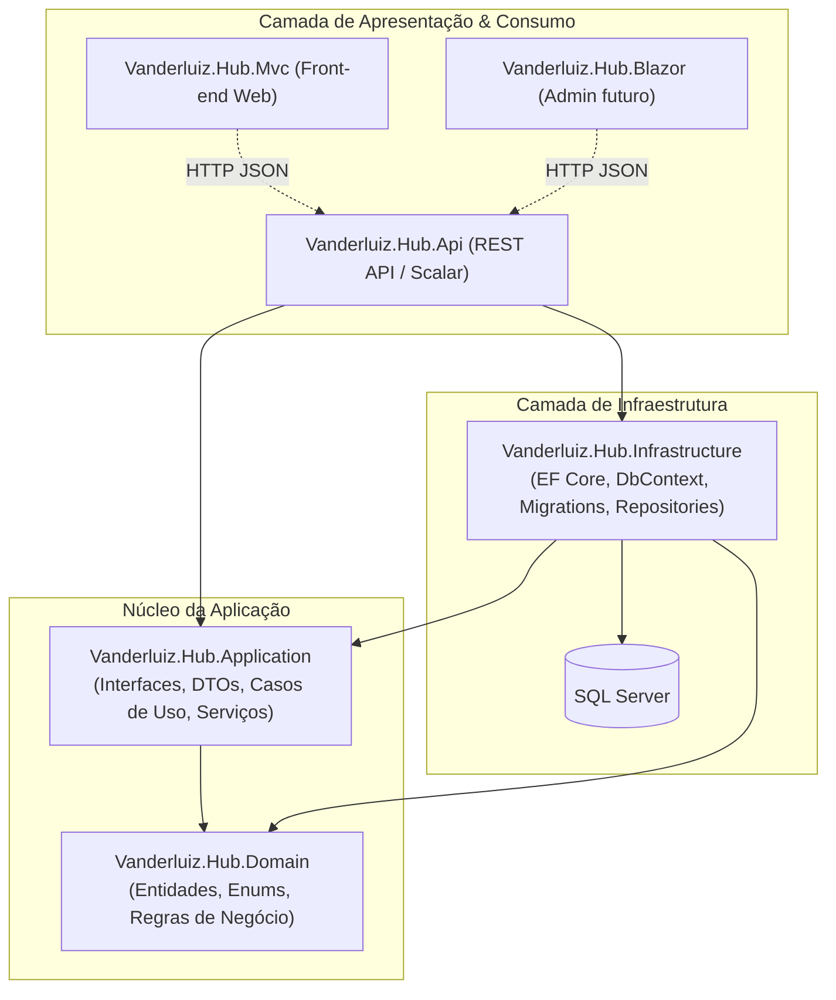
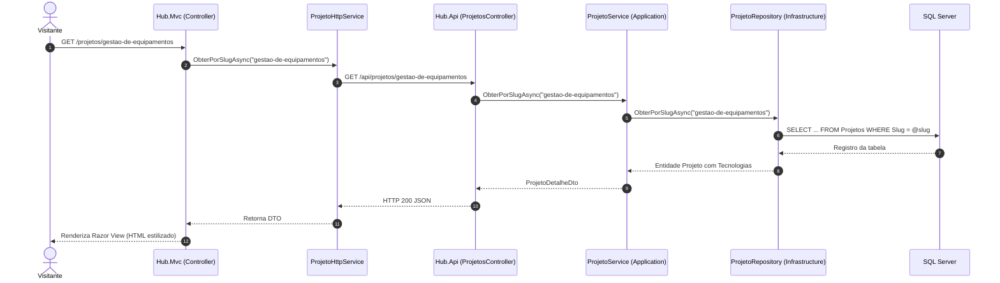
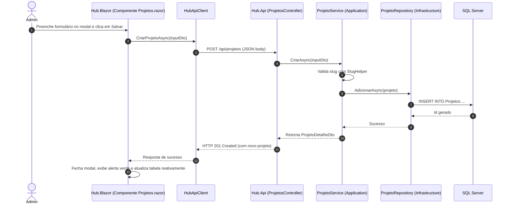

# Guia de Arquitetura — Vanderluiz Hub

Este documento descreve a organização técnica, padrões de projeto e decisões arquiteturais adotadas no **Vanderluiz.Hub**.

---

## 1. Visão Geral da Arquitetura

O projeto adota uma arquitetura em camadas inspirada nos princípios de **Clean Architecture** e **Onion Architecture**. A regra fundamental é:

> **A direção das dependências sempre aponta para dentro.**
> O Domínio não depende de ninguém; a Aplicação depende apenas do Domínio; a Infraestrutura e as interfaces externas (API, MVC, Blazor) dependem do Domínio e da Aplicação.

---

## 2. Responsabilidade de Cada Projeto

| Projeto | Responsabilidade | O que contém | O que NÃO deve conter |
| :--- | :--- | :--- | :--- |
| **`Vanderluiz.Hub.Domain`** | Coração do sistema e modelos puros de negócio. | Entidades (`Projeto`, `Tecnologia`, `Experiencia`, `Formacao`, `Post`), Enums (`StatusProjeto`, `NivelTecnologia`). | Referências a banco, Entity Framework, HTTP ou frameworks externos. |
| **`Vanderluiz.Hub.Application`** | Casos de uso, orquestração e contratos. | DTOs (`ProjetoResumoDto`, etc.), Interfaces de serviços (`IProjetoService`), Interfaces de repositórios (`IProjetoRepository`), Mappings manuais, Utilitários (`SlugHelper`). | Queries diretas a banco, EF Core, Controllers, Views. |
| **`Vanderluiz.Hub.Infrastructure`** | Acesso a dados e comunicação com ferramentas externas. | `HubDbContext`, Mapeamento com Fluent API (`Configurations`), Implementação dos repositórios (`ProjetoRepository`), Migrations, `DbInitializer` (seed). | Regras de apresentação ou controllers. |
| **`Vanderluiz.Hub.Api`** | Exposição dos dados via HTTP RESTful para múltiplos clientes. | Controllers REST (`/api/projetos`, etc.), documentação interativa (OpenAPI + Scalar), políticas de CORS. | Lógica de negócio pesada (ela delega para os Services da Application). |
| **`Vanderluiz.Hub.Mvc`** | Interface visual do portfólio para o usuário final. | Controllers MVC, Razor Views (`.cshtml`), ViewModels, CSS customizado, tema escuro, clientes HTTP (`ProjetoHttpService`). | Acesso direto a tabelas do banco no modo API. |
| **`Vanderluiz.Hub.Blazor`** | Painel administrativo interativo para gerenciar o conteúdo. | Componentes interativos Blazor, Dashboard com contadores, formulários reativos de criação/edição e exclusão com modal. | Acesso direto a banco (consome a API via HTTP com `HubApiClient`). |

---

## 3. Fluxos de Execução na Prática

### Fluxo 1: Visitante visualizando um projeto no MVC
Quando um visitante acessa `https://seusite.com/projetos/gestao-de-equipamentos`:

### Fluxo 2: Administrador criando/editando um projeto no Blazor
Quando você cadastra ou edita um projeto no Painel Admin (`/projetos`):

---

## 4. Por Que Essa Arquitetura é Poderosa?

1. **Desacoplamento Real:** O Front-end (MVC hoje, Blazor amanhã, aplicativo mobile depois) não conhece SQL, migrations ou Entity Framework. Ele consome a API através de contratos (DTOs).
2. **Facilidade de Troca e Teste:** As interfaces (`IProjetoService`, `IProjetoRepository`) permitem criar testes unitários com mocks facilmente, sem precisar de banco de dados real.
3. **Dual Mode no MVC:** O MVC possui uma chave `"Api:UsarApi"` no `appsettings.json`:
   - `true`: Consome a Web API via HTTP (`ProjetoHttpService`).
   - `false`: Conecta direto aos serviços locais de infraestrutura (útil para desenvolvimento rápido sem precisar subir dois processos).
4. **Segurança de URLs Amigáveis:** O `SlugHelper` transforma qualquer título (ex: `"Gestão de Equipamentos"`) em slugs limpos (`gestao-de-equipamentos`), sem acentuação e seguros para SEO e rotas REST.

